# dependency-map/group-1

[解析トップへ戻る](../../README.md)

このグループは表示用の区切りです。独立した実行モジュールではありません。

```mermaid
graph TD
    n-src-ink-app-tsx-c80523["app.tsx\nsrc/ink/app.tsx"]
    n-src-ink-index-tsx-e32f6e["index.tsx\nsrc/ink/index.tsx"]
    n-robot-agent-cli-py-b2929f["cli.py\nrobot_agent/cli.py"]
    n-src-ink-pythonbridge-ts-57bd96["pythonBridge.ts\nsrc/ink/pythonBridge.ts"]
    n-src-ink-types-ts-2f3f67["types.ts\nsrc/ink/types.ts"]
    n-src-ink-components-skilllist-tsx-af9524["SkillList.tsx\nsrc/ink/components/SkillList.tsx"]
    n-src-ink-components-chatlog-tsx-8d1edf["ChatLog.tsx\nsrc/ink/components/ChatLog.tsx"]
    n-src-ink-components-commandinput-tsx-26e00f["CommandInput.tsx\nsrc/ink/components/CommandInput.tsx"]
```

## 要素の説明

### n-robot-agent-cli-py-b2929f

確認済みファイル: `robot_agent/cli.py`

解析: Python AST。静的なimport／export参照です。関数の実行順序やHTTP通信は表していません。

宣言: `_print_command`, `_parse_and_check`, `parse`, `run`, `_skill_to_json`, `parse_json`, `skills_json`, `execute_json`, `ollama_models_json`, `llm_chat_json`, `trace_parse_json`, `ui`, `chat`, `_render_skill_table`, `skills_default`, `skills_list`, `skills_show`, `skills_add`, `skills_remove`, `main`

- `__future__` → 外部・標準ライブラリ・別名など。ローカル対応先は未確定
- `json` → 外部・標準ライブラリ・別名など。ローカル対応先は未確定
- `pathlib` → 外部・標準ライブラリ・別名など。ローカル対応先は未確定
- `typer` → 外部・標準ライブラリ・別名など。ローカル対応先は未確定
- `dotenv` → 外部・標準ライブラリ・別名など。ローカル対応先は未確定
- `rich.console` → 外部・標準ライブラリ・別名など。ローカル対応先は未確定
- `rich.panel` → 外部・標準ライブラリ・別名など。ローカル対応先は未確定
- `rich.table` → 外部・標準ライブラリ・別名など。ローカル対応先は未確定
- `agent` → `robot_agent/agent.py`（内容確認済み）
- `openvla_client` → `robot_agent/openvla_client.py`（内容確認済み）
- `safety` → `robot_agent/safety.py`（内容確認済み）
- `schemas` → `robot_agent/schemas.py`（内容確認済み）
- `skills` → `robot_agent/skills.py`（内容確認済み）
- `ollama_test_client` → `robot_agent/ollama_test_client.py`（内容確認済み）
- `ollama_robot_trace_client` → `robot_agent/ollama_robot_trace_client.py`（一覧確認・内容未読）
- `task_trace` → `robot_agent/task_trace.py`（一覧確認・内容未読）
- `tui` → `robot_agent/tui.py`（一覧確認・内容未読）

[詳細な図と説明を見る](n-robot-agent-cli-py-b2929f/README.md)

### n-src-ink-app-tsx-c80523

確認済みファイル: `src/ink/app.tsx`

解析: 字句抽出。静的なimport／export参照です。関数の実行順序やHTTP通信は表していません。

宣言: `App`, `refreshSkills`, `refreshModels`, `runLast`, `handleLlmChat`, `runBenchmark`, `handleTrace`, `runTaskBench`, `handleSubmit`

- `react` → 外部・標準ライブラリ・別名など。ローカル対応先は未確定
- `ink` → 外部・標準ライブラリ・別名など。ローカル対応先は未確定
- `./pythonBridge.js` → `src/ink/pythonBridge.ts`（内容確認済み）
- `./types.js` → `src/ink/types.ts`（内容確認済み）
- `./components/SkillList.js` → `src/ink/components/SkillList.tsx`（内容確認済み）
- `./components/ChatLog.js` → `src/ink/components/ChatLog.tsx`（内容確認済み）
- `./components/CommandInput.js` → `src/ink/components/CommandInput.tsx`（内容確認済み）
- `./components/StatusBar.js` → `src/ink/components/StatusBar.tsx`（内容確認済み）

[詳細な図と説明を見る](n-src-ink-app-tsx-c80523/README.md)

### n-src-ink-components-chatlog-tsx-8d1edf

確認済みファイル: `src/ink/components/ChatLog.tsx`

解析: 字句抽出。静的なimport／export参照です。関数の実行順序やHTTP通信は表していません。

宣言: `ChatLog`

- `react` → 外部・標準ライブラリ・別名など。ローカル対応先は未確定
- `ink` → 外部・標準ライブラリ・別名など。ローカル対応先は未確定
- `../types.js` → `src/ink/types.ts`（内容確認済み）

[詳細な図と説明を見る](n-src-ink-components-chatlog-tsx-8d1edf/README.md)

### n-src-ink-components-commandinput-tsx-26e00f

確認済みファイル: `src/ink/components/CommandInput.tsx`

解析: 字句抽出。静的なimport／export参照です。関数の実行順序やHTTP通信は表していません。

宣言: `CommandInput`

- `react` → 外部・標準ライブラリ・別名など。ローカル対応先は未確定
- `ink` → 外部・標準ライブラリ・別名など。ローカル対応先は未確定
- `@inkjs/ui` → 外部・標準ライブラリ・別名など。ローカル対応先は未確定

[詳細な図と説明を見る](n-src-ink-components-commandinput-tsx-26e00f/README.md)

### n-src-ink-components-skilllist-tsx-af9524

確認済みファイル: `src/ink/components/SkillList.tsx`

解析: 字句抽出。静的なimport／export参照です。関数の実行順序やHTTP通信は表していません。

宣言: `SkillList`

- `react` → 外部・標準ライブラリ・別名など。ローカル対応先は未確定
- `ink` → 外部・標準ライブラリ・別名など。ローカル対応先は未確定
- `../pythonBridge.js` → `src/ink/pythonBridge.ts`（内容確認済み）

[詳細な図と説明を見る](n-src-ink-components-skilllist-tsx-af9524/README.md)

### n-src-ink-index-tsx-e32f6e

確認済みファイル: `src/ink/index.tsx`

解析: 字句抽出。静的なimport／export参照です。関数の実行順序やHTTP通信は表していません。

- `react` → 外部・標準ライブラリ・別名など。ローカル対応先は未確定
- `ink` → 外部・標準ライブラリ・別名など。ローカル対応先は未確定
- `./app.js` → `src/ink/app.tsx`（内容確認済み）

[詳細な図と説明を見る](n-src-ink-index-tsx-e32f6e/README.md)

### n-src-ink-pythonbridge-ts-57bd96

確認済みファイル: `src/ink/pythonBridge.ts`

解析: 字句抽出。静的なimport／export参照です。関数の実行順序やHTTP通信は表していません。

宣言: `pickStdoutJson`, `runJson`, `loadSkills`, `parseRobotCommand`, `loadOllamaModels`, `llmChatMeasured`, `traceRobotCommand`, `executeRobotCommand`

- `execa` → 外部・標準ライブラリ・別名など。ローカル対応先は未確定
- `zod` → 外部・標準ライブラリ・別名など。ローカル対応先は未確定

[詳細な図と説明を見る](n-src-ink-pythonbridge-ts-57bd96/README.md)

### n-src-ink-types-ts-2f3f67

確認済みファイル: `src/ink/types.ts`

解析: 字句抽出。静的なimport／export参照です。関数の実行順序やHTTP通信は表していません。

- `./pythonBridge.js` → `src/ink/pythonBridge.ts`（内容確認済み）

[詳細な図と説明を見る](n-src-ink-types-ts-2f3f67/README.md)

