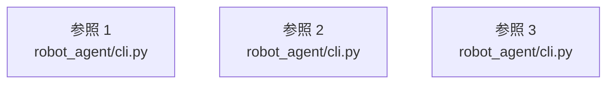

# dependency-map/group-1/n-robot-agent-cli-py-b2929f

[解析トップへ戻る](../../../README.md)

確認済みファイル: `robot_agent/cli.py`

解析: Python AST。静的なimport／export参照です。関数の実行順序やHTTP通信は表していません。

宣言: `_print_command`, `_parse_and_check`, `parse`, `run`, `_skill_to_json`, `parse_json`, `skills_json`, `execute_json`, `ollama_models_json`, `llm_chat_json`, `trace_parse_json`, `ui`, `chat`, `_render_skill_table`, `skills_default`, `skills_list`, `skills_show`, `skills_add`, `skills_remove`, `main`

- `__future__` → 外部・標準ライブラリ・別名など。ローカル対応先は未確定
- `json` → 外部・標準ライブラリ・別名など。ローカル対応先は未確定
- `pathlib` → 外部・標準ライブラリ・別名など。ローカル対応先は未確定
- `typer` → 外部・標準ライブラリ・別名など。ローカル対応先は未確定
- `dotenv` → 外部・標準ライブラリ・別名など。ローカル対応先は未確定
- `rich.console` → 外部・標準ライブラリ・別名など。ローカル対応先は未確定
- `rich.panel` → 外部・標準ライブラリ・別名など。ローカル対応先は未確定
- `rich.table` → 外部・標準ライブラリ・別名など。ローカル対応先は未確定
- `agent` → `robot_agent/agent.py`（内容確認済み）
- `openvla_client` → `robot_agent/openvla_client.py`（内容確認済み）
- `safety` → `robot_agent/safety.py`（内容確認済み）
- `schemas` → `robot_agent/schemas.py`（内容確認済み）
- `skills` → `robot_agent/skills.py`（内容確認済み）
- `ollama_test_client` → `robot_agent/ollama_test_client.py`（内容確認済み）
- `ollama_robot_trace_client` → `robot_agent/ollama_robot_trace_client.py`（一覧確認・内容未読）
- `task_trace` → `robot_agent/task_trace.py`（一覧確認・内容未読）
- `tui` → `robot_agent/tui.py`（一覧確認・内容未読）

## 要素の説明

### imports-1

import参照の表示用グループ。

[詳細な図と説明を見る](imports-1/README.md)

### imports-2

import参照の表示用グループ。

[詳細な図と説明を見る](imports-2/README.md)

### imports-3

import参照の表示用グループ。

[詳細な図と説明を見る](imports-3/README.md)

