# dependency-map/group-1/n-robot-agent-cli-py-b2929f/imports-2

[解析トップへ戻る](../../../../README.md)

import参照の表示用グループ。

```mermaid
graph TD
    source["ソース\nrobot_agent/cli.py"]
    n-agent-0608c4["agent\nrobot_agent/agent.py"]
    source -->|"Python AST: import／export"| n-agent-0608c4
    n-openvla-client-f6a70c["openvla_client\nrobot_agent/openvla_client.py"]
    source -->|"Python AST: import／export"| n-openvla-client-f6a70c
    n-safety-be6c32["safety\nrobot_agent/safety.py"]
    source -->|"Python AST: import／export"| n-safety-be6c32
    n-schemas-c20018["schemas\nrobot_agent/schemas.py"]
    source -->|"Python AST: import／export"| n-schemas-c20018
    n-skills-816f2b["skills\nrobot_agent/skills.py"]
    source -->|"Python AST: import／export"| n-skills-816f2b
    n-ollama-test-client-2c342f["ollama_test_client\nrobot_agent/ollama_test_client.py"]
    source -->|"Python AST: import／export"| n-ollama-test-client-2c342f
    n-ollama-robot-trace-client-76c623["ollama_robot_trace_client\nrobot_agent/ollama_robot_trace_client.py"]
    source -->|"Python AST: import／export"| n-ollama-robot-trace-client-76c623
    n-task-trace-073fea["task_trace\nrobot_agent/task_trace.py"]
    source -->|"Python AST: import／export"| n-task-trace-073fea
```

## 要素の説明

### n-agent-0608c4

参照名: `agent`

対応する実在ソース: `robot_agent/agent.py`。内容確認済み。

### n-ollama-robot-trace-client-76c623

参照名: `ollama_robot_trace_client`

対応する実在ソース: `robot_agent/ollama_robot_trace_client.py`。内容は未読。

### n-ollama-test-client-2c342f

参照名: `ollama_test_client`

対応する実在ソース: `robot_agent/ollama_test_client.py`。内容確認済み。

### n-openvla-client-f6a70c

参照名: `openvla_client`

対応する実在ソース: `robot_agent/openvla_client.py`。内容確認済み。

### n-safety-be6c32

参照名: `safety`

対応する実在ソース: `robot_agent/safety.py`。内容確認済み。

### n-schemas-c20018

参照名: `schemas`

対応する実在ソース: `robot_agent/schemas.py`。内容確認済み。

### n-skills-816f2b

参照名: `skills`

対応する実在ソース: `robot_agent/skills.py`。内容確認済み。

### n-task-trace-073fea

参照名: `task_trace`

対応する実在ソース: `robot_agent/task_trace.py`。内容は未読。

### source

`robot_agent/cli.py` の内容を確認しました。

