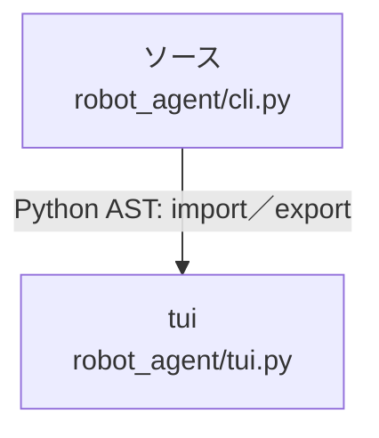

# dependency-map/group-1/n-robot-agent-cli-py-b2929f/imports-3

[解析トップへ戻る](../../../../README.md)

import参照の表示用グループ。

## 要素の説明

### n-tui-864e24

参照名: `tui`

対応する実在ソース: `robot_agent/tui.py`。内容は未読。

### source

`robot_agent/cli.py` の内容を確認しました。

