# dependency-map/group-1/n-src-ink-app-tsx-c80523

[解析トップへ戻る](../../../README.md)

確認済みファイル: `src/ink/app.tsx`

解析: 字句抽出。静的なimport／export参照です。関数の実行順序やHTTP通信は表していません。

宣言: `App`, `refreshSkills`, `refreshModels`, `runLast`, `handleLlmChat`, `runBenchmark`, `handleTrace`, `runTaskBench`, `handleSubmit`

- `react` → 外部・標準ライブラリ・別名など。ローカル対応先は未確定
- `ink` → 外部・標準ライブラリ・別名など。ローカル対応先は未確定
- `./pythonBridge.js` → `src/ink/pythonBridge.ts`（内容確認済み）
- `./types.js` → `src/ink/types.ts`（内容確認済み）
- `./components/SkillList.js` → `src/ink/components/SkillList.tsx`（内容確認済み）
- `./components/ChatLog.js` → `src/ink/components/ChatLog.tsx`（内容確認済み）
- `./components/CommandInput.js` → `src/ink/components/CommandInput.tsx`（内容確認済み）
- `./components/StatusBar.js` → `src/ink/components/StatusBar.tsx`（内容確認済み）

```mermaid
graph TD
    source["ソース\nsrc/ink/app.tsx"]
    n-react-6b810c["react\n外部・別名・未解決"]
    source -->|"字句抽出: import／export"| n-react-6b810c
    n-ink-ec437a["ink\n外部・別名・未解決"]
    source -->|"字句抽出: import／export"| n-ink-ec437a
    n-pythonbridge-js-b53cd4["./pythonBridge.js\nsrc/ink/pythonBridge.ts"]
    source -->|"字句抽出: import／export"| n-pythonbridge-js-b53cd4
    n-types-js-eb4bb1["./types.js\nsrc/ink/types.ts"]
    source -->|"字句抽出: import／export"| n-types-js-eb4bb1
    n-components-skilllist-js-b1aa87["./components/SkillList.js\nsrc/ink/components/SkillList.tsx"]
    source -->|"字句抽出: import／export"| n-components-skilllist-js-b1aa87
    n-components-chatlog-js-b1e22c["./components/ChatLog.js\nsrc/ink/components/ChatLog.tsx"]
    source -->|"字句抽出: import／export"| n-components-chatlog-js-b1e22c
    n-components-commandinput-js-850c69["./components/CommandInput.js\nsrc/ink/components/CommandInput.tsx"]
    source -->|"字句抽出: import／export"| n-components-commandinput-js-850c69
    n-components-statusbar-js-0486cf["./components/StatusBar.js\nsrc/ink/components/StatusBar.tsx"]
    source -->|"字句抽出: import／export"| n-components-statusbar-js-0486cf
```

## 要素の説明

### n-components-chatlog-js-b1e22c

参照名: `./components/ChatLog.js`

対応する実在ソース: `src/ink/components/ChatLog.tsx`。内容確認済み。

### n-components-commandinput-js-850c69

参照名: `./components/CommandInput.js`

対応する実在ソース: `src/ink/components/CommandInput.tsx`。内容確認済み。

### n-components-skilllist-js-b1aa87

参照名: `./components/SkillList.js`

対応する実在ソース: `src/ink/components/SkillList.tsx`。内容確認済み。

### n-components-statusbar-js-0486cf

参照名: `./components/StatusBar.js`

対応する実在ソース: `src/ink/components/StatusBar.tsx`。内容確認済み。

### n-ink-ec437a

参照名: `ink`

ローカルのソース対応先を確定できませんでした。外部ライブラリ、標準ライブラリ、型別名などを区別する追加確認が必要です。

### n-pythonbridge-js-b53cd4

参照名: `./pythonBridge.js`

対応する実在ソース: `src/ink/pythonBridge.ts`。内容確認済み。

### n-react-6b810c

参照名: `react`

ローカルのソース対応先を確定できませんでした。外部ライブラリ、標準ライブラリ、型別名などを区別する追加確認が必要です。

### n-types-js-eb4bb1

参照名: `./types.js`

対応する実在ソース: `src/ink/types.ts`。内容確認済み。

### source

`src/ink/app.tsx` の内容を確認しました。

