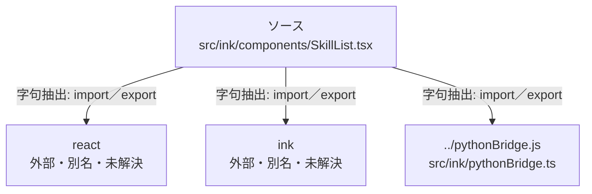

# dependency-map/group-1/n-src-ink-components-skilllist-tsx-af9524

[解析トップへ戻る](../../../README.md)

確認済みファイル: `src/ink/components/SkillList.tsx`

解析: 字句抽出。静的なimport／export参照です。関数の実行順序やHTTP通信は表していません。

宣言: `SkillList`

- `react` → 外部・標準ライブラリ・別名など。ローカル対応先は未確定
- `ink` → 外部・標準ライブラリ・別名など。ローカル対応先は未確定
- `../pythonBridge.js` → `src/ink/pythonBridge.ts`（内容確認済み）

## 要素の説明

### n-ink-ec437a

参照名: `ink`

ローカルのソース対応先を確定できませんでした。外部ライブラリ、標準ライブラリ、型別名などを区別する追加確認が必要です。

### n-pythonbridge-js-d72ddb

参照名: `../pythonBridge.js`

対応する実在ソース: `src/ink/pythonBridge.ts`。内容確認済み。

### n-react-6b810c

参照名: `react`

ローカルのソース対応先を確定できませんでした。外部ライブラリ、標準ライブラリ、型別名などを区別する追加確認が必要です。

### source

`src/ink/components/SkillList.tsx` の内容を確認しました。

