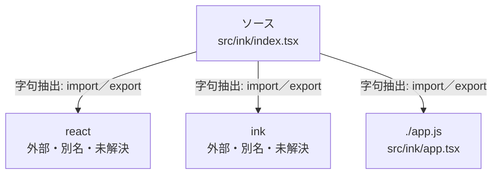

# dependency-map/group-1/n-src-ink-index-tsx-e32f6e

[解析トップへ戻る](../../../README.md)

確認済みファイル: `src/ink/index.tsx`

解析: 字句抽出。静的なimport／export参照です。関数の実行順序やHTTP通信は表していません。

- `react` → 外部・標準ライブラリ・別名など。ローカル対応先は未確定
- `ink` → 外部・標準ライブラリ・別名など。ローカル対応先は未確定
- `./app.js` → `src/ink/app.tsx`（内容確認済み）

## 要素の説明

### n-app-js-ab7bbd

参照名: `./app.js`

対応する実在ソース: `src/ink/app.tsx`。内容確認済み。

### n-ink-ec437a

参照名: `ink`

ローカルのソース対応先を確定できませんでした。外部ライブラリ、標準ライブラリ、型別名などを区別する追加確認が必要です。

### n-react-6b810c

参照名: `react`

ローカルのソース対応先を確定できませんでした。外部ライブラリ、標準ライブラリ、型別名などを区別する追加確認が必要です。

### source

`src/ink/index.tsx` の内容を確認しました。

