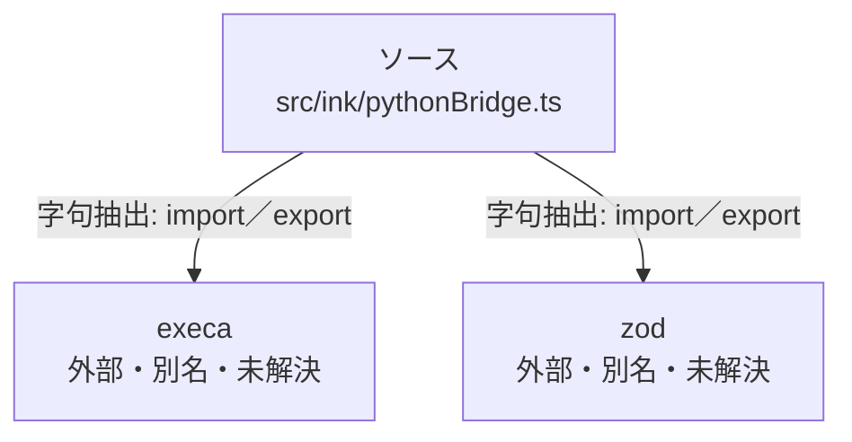

# dependency-map/group-1/n-src-ink-pythonbridge-ts-57bd96

[解析トップへ戻る](../../../README.md)

確認済みファイル: `src/ink/pythonBridge.ts`

解析: 字句抽出。静的なimport／export参照です。関数の実行順序やHTTP通信は表していません。

宣言: `pickStdoutJson`, `runJson`, `loadSkills`, `parseRobotCommand`, `loadOllamaModels`, `llmChatMeasured`, `traceRobotCommand`, `executeRobotCommand`

- `execa` → 外部・標準ライブラリ・別名など。ローカル対応先は未確定
- `zod` → 外部・標準ライブラリ・別名など。ローカル対応先は未確定

## 要素の説明

### n-execa-b0bf15

参照名: `execa`

ローカルのソース対応先を確定できませんでした。外部ライブラリ、標準ライブラリ、型別名などを区別する追加確認が必要です。

### n-zod-370c9d

参照名: `zod`

ローカルのソース対応先を確定できませんでした。外部ライブラリ、標準ライブラリ、型別名などを区別する追加確認が必要です。

### source

`src/ink/pythonBridge.ts` の内容を確認しました。

