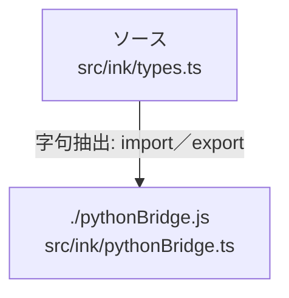

# dependency-map/group-1/n-src-ink-types-ts-2f3f67

[解析トップへ戻る](../../../README.md)

確認済みファイル: `src/ink/types.ts`

解析: 字句抽出。静的なimport／export参照です。関数の実行順序やHTTP通信は表していません。

- `./pythonBridge.js` → `src/ink/pythonBridge.ts`（内容確認済み）

## 要素の説明

### n-pythonbridge-js-b53cd4

参照名: `./pythonBridge.js`

対応する実在ソース: `src/ink/pythonBridge.ts`。内容確認済み。

### source

`src/ink/types.ts` の内容を確認しました。

