# dependency-map/group-2

[解析トップへ戻る](../../README.md)

このグループは表示用の区切りです。独立した実行モジュールではありません。

```mermaid
graph TD
    n-src-ink-components-statusbar-tsx-ab07e6["StatusBar.tsx\nsrc/ink/components/StatusBar.tsx"]
    n-robot-agent-agent-py-0b5265["agent.py\nrobot_agent/agent.py"]
    n-robot-agent-openvla-client-py-99550d["openvla_client.py\nrobot_agent/openvla_client.py"]
    n-robot-agent-safety-py-70dae6["safety.py\nrobot_agent/safety.py"]
    n-robot-agent-schemas-py-22f19f["schemas.py\nrobot_agent/schemas.py"]
    n-robot-agent-skills-py-d3a3e6["skills.py\nrobot_agent/skills.py"]
    n-robot-agent-ollama-test-client-py-8d86a5["ollama_test_client.py\nrobot_agent/ollama_test_client.py"]
```

## 要素の説明

### n-robot-agent-agent-py-0b5265

確認済みファイル: `robot_agent/agent.py`

解析: Python AST。静的なimport／export参照です。関数の実行順序やHTTP通信は表していません。

宣言: `configure_llm_client`, `extract_json`, `build_robot_agent`, `_normalize_color`, `postprocess_command`, `make_blocked_command`, `_coerce_nulls`, `normalize_command`

- `__future__` → 外部・標準ライブラリ・別名など。ローカル対応先は未確定
- `json` → 外部・標準ライブラリ・別名など。ローカル対応先は未確定
- `os` → 外部・標準ライブラリ・別名など。ローカル対応先は未確定
- `re` → 外部・標準ライブラリ・別名など。ローカル対応先は未確定
- `agents` → 外部・標準ライブラリ・別名など。ローカル対応先は未確定
- `openai` → 外部・標準ライブラリ・別名など。ローカル対応先は未確定
- `prompts` → `robot_agent/prompts.py`（一覧確認・内容未読）
- `schemas` → `robot_agent/schemas.py`（内容確認済み）
- `skills` → `robot_agent/skills.py`（内容確認済み）

[詳細な図と説明を見る](n-robot-agent-agent-py-0b5265/README.md)

### n-robot-agent-ollama-test-client-py-8d86a5

確認済みファイル: `robot_agent/ollama_test_client.py`

解析: Python AST。静的なimport／export参照です。関数の実行順序やHTTP通信は表していません。

宣言: `LLMChatResult`, `ollama_base_url`, `list_ollama_models`, `chat_with_ollama_measured`

- `__future__` → 外部・標準ライブラリ・別名など。ローカル対応先は未確定
- `json` → 外部・標準ライブラリ・別名など。ローカル対応先は未確定
- `os` → 外部・標準ライブラリ・別名など。ローカル対応先は未確定
- `time` → 外部・標準ライブラリ・別名など。ローカル対応先は未確定
- `dataclasses` → 外部・標準ライブラリ・別名など。ローカル対応先は未確定
- `typing` → 外部・標準ライブラリ・別名など。ローカル対応先は未確定
- `httpx` → 外部・標準ライブラリ・別名など。ローカル対応先は未確定
- `system_metrics` → `robot_agent/system_metrics.py`（一覧確認・内容未読）

[詳細な図と説明を見る](n-robot-agent-ollama-test-client-py-8d86a5/README.md)

### n-robot-agent-openvla-client-py-99550d

確認済みファイル: `robot_agent/openvla_client.py`

解析: Python AST。静的なimport／export参照です。関数の実行順序やHTTP通信は表していません。

宣言: `OpenVLAResult`, `send_to_openvla`

- `__future__` → 外部・標準ライブラリ・別名など。ローカル対応先は未確定
- `os` → 外部・標準ライブラリ・別名など。ローカル対応先は未確定
- `typing` → 外部・標準ライブラリ・別名など。ローカル対応先は未確定
- `httpx` → 外部・標準ライブラリ・別名など。ローカル対応先は未確定
- `pydantic` → 外部・標準ライブラリ・別名など。ローカル対応先は未確定
- `schemas` → `robot_agent/schemas.py`（内容確認済み）

[詳細な図と説明を見る](n-robot-agent-openvla-client-py-99550d/README.md)

### n-robot-agent-safety-py-70dae6

確認済みファイル: `robot_agent/safety.py`

解析: Python AST。静的なimport／export参照です。関数の実行順序やHTTP通信は表していません。

宣言: `safety_check`

- `__future__` → 外部・標準ライブラリ・別名など。ローカル対応先は未確定
- `schemas` → `robot_agent/schemas.py`（内容確認済み）
- `skills` → `robot_agent/skills.py`（内容確認済み）

[詳細な図と説明を見る](n-robot-agent-safety-py-70dae6/README.md)

### n-robot-agent-schemas-py-22f19f

確認済みファイル: `robot_agent/schemas.py`

解析: Python AST。静的なimport／export参照です。関数の実行順序やHTTP通信は表していません。

宣言: `Skill`, `SkillRegistry`, `RobotCommand`, `SafetyResult`, `LLMTraceMetrics`, `PromptMessage`, `PromptTrace`, `TaskTraceEvaluation`, `TaskTraceResult`

- `__future__` → 外部・標準ライブラリ・別名など。ローカル対応先は未確定
- `typing` → 外部・標準ライブラリ・別名など。ローカル対応先は未確定
- `pydantic` → 外部・標準ライブラリ・別名など。ローカル対応先は未確定

[詳細な図と説明を見る](n-robot-agent-schemas-py-22f19f/README.md)

### n-robot-agent-skills-py-d3a3e6

確認済みファイル: `robot_agent/skills.py`

解析: Python AST。静的なimport／export参照です。関数の実行順序やHTTP通信は表していません。

宣言: `load_skill_registry`, `save_skill_registry`, `_skill_to_yaml_dict`, `render_skill_list`, `find_skill`, `add_skill`, `remove_skill`

- `__future__` → 外部・標準ライブラリ・別名など。ローカル対応先は未確定
- `pathlib` → 外部・標準ライブラリ・別名など。ローカル対応先は未確定
- `typing` → 外部・標準ライブラリ・別名など。ローカル対応先は未確定
- `yaml` → 外部・標準ライブラリ・別名など。ローカル対応先は未確定
- `schemas` → `robot_agent/schemas.py`（内容確認済み）

[詳細な図と説明を見る](n-robot-agent-skills-py-d3a3e6/README.md)

### n-src-ink-components-statusbar-tsx-ab07e6

確認済みファイル: `src/ink/components/StatusBar.tsx`

解析: 字句抽出。静的なimport／export参照です。関数の実行順序やHTTP通信は表していません。

宣言: `StatusBar`

- `react` → 外部・標準ライブラリ・別名など。ローカル対応先は未確定
- `ink` → 外部・標準ライブラリ・別名など。ローカル対応先は未確定

[詳細な図と説明を見る](n-src-ink-components-statusbar-tsx-ab07e6/README.md)

