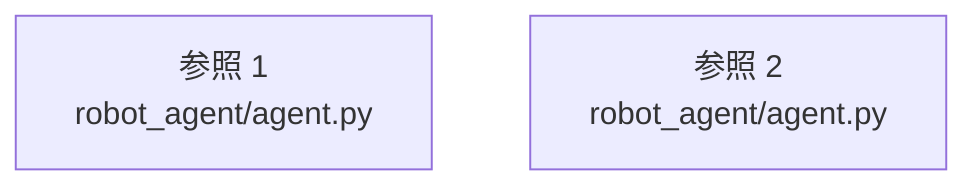

# dependency-map/group-2/n-robot-agent-agent-py-0b5265

[解析トップへ戻る](../../../README.md)

確認済みファイル: `robot_agent/agent.py`

解析: Python AST。静的なimport／export参照です。関数の実行順序やHTTP通信は表していません。

宣言: `configure_llm_client`, `extract_json`, `build_robot_agent`, `_normalize_color`, `postprocess_command`, `make_blocked_command`, `_coerce_nulls`, `normalize_command`

- `__future__` → 外部・標準ライブラリ・別名など。ローカル対応先は未確定
- `json` → 外部・標準ライブラリ・別名など。ローカル対応先は未確定
- `os` → 外部・標準ライブラリ・別名など。ローカル対応先は未確定
- `re` → 外部・標準ライブラリ・別名など。ローカル対応先は未確定
- `agents` → 外部・標準ライブラリ・別名など。ローカル対応先は未確定
- `openai` → 外部・標準ライブラリ・別名など。ローカル対応先は未確定
- `prompts` → `robot_agent/prompts.py`（一覧確認・内容未読）
- `schemas` → `robot_agent/schemas.py`（内容確認済み）
- `skills` → `robot_agent/skills.py`（内容確認済み）

## 要素の説明

### imports-1

import参照の表示用グループ。

[詳細な図と説明を見る](imports-1/README.md)

### imports-2

import参照の表示用グループ。

[詳細な図と説明を見る](imports-2/README.md)

