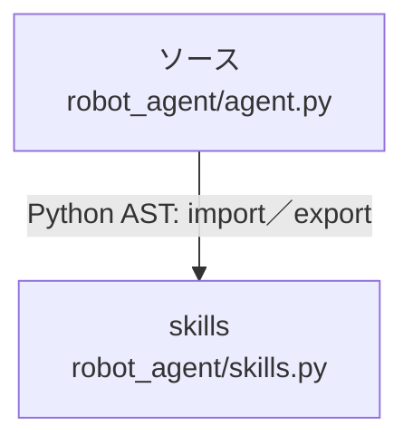

# dependency-map/group-2/n-robot-agent-agent-py-0b5265/imports-2

[解析トップへ戻る](../../../../README.md)

import参照の表示用グループ。

## 要素の説明

### n-skills-816f2b

参照名: `skills`

対応する実在ソース: `robot_agent/skills.py`。内容確認済み。

### source

`robot_agent/agent.py` の内容を確認しました。

