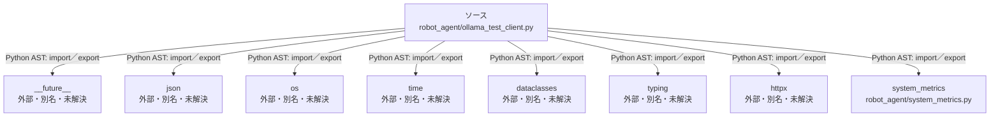

# dependency-map/group-2/n-robot-agent-ollama-test-client-py-8d86a5

[解析トップへ戻る](../../../README.md)

確認済みファイル: `robot_agent/ollama_test_client.py`

解析: Python AST。静的なimport／export参照です。関数の実行順序やHTTP通信は表していません。

宣言: `LLMChatResult`, `ollama_base_url`, `list_ollama_models`, `chat_with_ollama_measured`

- `__future__` → 外部・標準ライブラリ・別名など。ローカル対応先は未確定
- `json` → 外部・標準ライブラリ・別名など。ローカル対応先は未確定
- `os` → 外部・標準ライブラリ・別名など。ローカル対応先は未確定
- `time` → 外部・標準ライブラリ・別名など。ローカル対応先は未確定
- `dataclasses` → 外部・標準ライブラリ・別名など。ローカル対応先は未確定
- `typing` → 外部・標準ライブラリ・別名など。ローカル対応先は未確定
- `httpx` → 外部・標準ライブラリ・別名など。ローカル対応先は未確定
- `system_metrics` → `robot_agent/system_metrics.py`（一覧確認・内容未読）

## 要素の説明

### n-dataclasses-cebf61

参照名: `dataclasses`

ローカルのソース対応先を確定できませんでした。外部ライブラリ、標準ライブラリ、型別名などを区別する追加確認が必要です。

### n-future-05a733

参照名: `__future__`

ローカルのソース対応先を確定できませんでした。外部ライブラリ、標準ライブラリ、型別名などを区別する追加確認が必要です。

### n-httpx-f79177

参照名: `httpx`

ローカルのソース対応先を確定できませんでした。外部ライブラリ、標準ライブラリ、型別名などを区別する追加確認が必要です。

### n-json-05d97e

参照名: `json`

ローカルのソース対応先を確定できませんでした。外部ライブラリ、標準ライブラリ、型別名などを区別する追加確認が必要です。

### n-os-999a34

参照名: `os`

ローカルのソース対応先を確定できませんでした。外部ライブラリ、標準ライブラリ、型別名などを区別する追加確認が必要です。

### n-system-metrics-147d37

参照名: `system_metrics`

対応する実在ソース: `robot_agent/system_metrics.py`。内容は未読。

### n-time-714eea

参照名: `time`

ローカルのソース対応先を確定できませんでした。外部ライブラリ、標準ライブラリ、型別名などを区別する追加確認が必要です。

### n-typing-02d7d3

参照名: `typing`

ローカルのソース対応先を確定できませんでした。外部ライブラリ、標準ライブラリ、型別名などを区別する追加確認が必要です。

### source

`robot_agent/ollama_test_client.py` の内容を確認しました。

