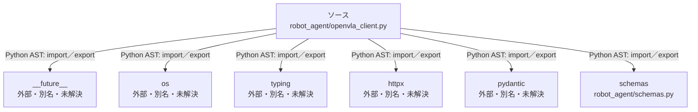

# dependency-map/group-2/n-robot-agent-openvla-client-py-99550d

[解析トップへ戻る](../../../README.md)

確認済みファイル: `robot_agent/openvla_client.py`

解析: Python AST。静的なimport／export参照です。関数の実行順序やHTTP通信は表していません。

宣言: `OpenVLAResult`, `send_to_openvla`

- `__future__` → 外部・標準ライブラリ・別名など。ローカル対応先は未確定
- `os` → 外部・標準ライブラリ・別名など。ローカル対応先は未確定
- `typing` → 外部・標準ライブラリ・別名など。ローカル対応先は未確定
- `httpx` → 外部・標準ライブラリ・別名など。ローカル対応先は未確定
- `pydantic` → 外部・標準ライブラリ・別名など。ローカル対応先は未確定
- `schemas` → `robot_agent/schemas.py`（内容確認済み）

## 要素の説明

### n-future-05a733

参照名: `__future__`

ローカルのソース対応先を確定できませんでした。外部ライブラリ、標準ライブラリ、型別名などを区別する追加確認が必要です。

### n-httpx-f79177

参照名: `httpx`

ローカルのソース対応先を確定できませんでした。外部ライブラリ、標準ライブラリ、型別名などを区別する追加確認が必要です。

### n-os-999a34

参照名: `os`

ローカルのソース対応先を確定できませんでした。外部ライブラリ、標準ライブラリ、型別名などを区別する追加確認が必要です。

### n-pydantic-196fee

参照名: `pydantic`

ローカルのソース対応先を確定できませんでした。外部ライブラリ、標準ライブラリ、型別名などを区別する追加確認が必要です。

### n-schemas-c20018

参照名: `schemas`

対応する実在ソース: `robot_agent/schemas.py`。内容確認済み。

### n-typing-02d7d3

参照名: `typing`

ローカルのソース対応先を確定できませんでした。外部ライブラリ、標準ライブラリ、型別名などを区別する追加確認が必要です。

### source

`robot_agent/openvla_client.py` の内容を確認しました。

