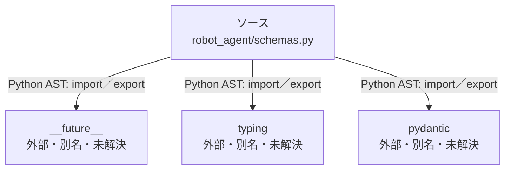

# dependency-map/group-2/n-robot-agent-schemas-py-22f19f

[解析トップへ戻る](../../../README.md)

確認済みファイル: `robot_agent/schemas.py`

解析: Python AST。静的なimport／export参照です。関数の実行順序やHTTP通信は表していません。

宣言: `Skill`, `SkillRegistry`, `RobotCommand`, `SafetyResult`, `LLMTraceMetrics`, `PromptMessage`, `PromptTrace`, `TaskTraceEvaluation`, `TaskTraceResult`

- `__future__` → 外部・標準ライブラリ・別名など。ローカル対応先は未確定
- `typing` → 外部・標準ライブラリ・別名など。ローカル対応先は未確定
- `pydantic` → 外部・標準ライブラリ・別名など。ローカル対応先は未確定

## 要素の説明

### n-future-05a733

参照名: `__future__`

ローカルのソース対応先を確定できませんでした。外部ライブラリ、標準ライブラリ、型別名などを区別する追加確認が必要です。

### n-pydantic-196fee

参照名: `pydantic`

ローカルのソース対応先を確定できませんでした。外部ライブラリ、標準ライブラリ、型別名などを区別する追加確認が必要です。

### n-typing-02d7d3

参照名: `typing`

ローカルのソース対応先を確定できませんでした。外部ライブラリ、標準ライブラリ、型別名などを区別する追加確認が必要です。

### source

`robot_agent/schemas.py` の内容を確認しました。

