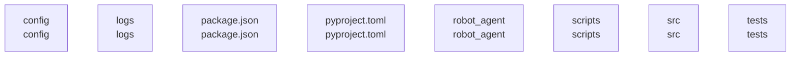

# overall-architecture

[解析トップへ戻る](../README.md)

# robot_subagent

ロボット向け命令を整形するPython CLIと、InkによるターミナルUI。

この図はリポジトリ内の構成です。コードを実行した結果やサービス間の通信保証ではありません。

## 対象と根拠

対象: https://github.com/FORIFOR/robot_subagent

取得ブランチ: `main`

Git tree SHA: `4aa5802d360f27825406f196d8c0c69122334e53`

ファイル一覧: 32件。内容確認: 18件。全ファイルの意味解析ではありません。

## 解析の制約

実コードの取得は入口、マニフェスト、直接参照先を中心とする初回解析です。動的ロード、実行時設定、別リポジトリとの接続、ローカル未コミット変更は未確認です。

## 確認が必要な点

構成図の配置関係と、実際の通信・呼び出し関係を区別してください。README上の機能や精度の記述は動作検証済みという意味ではありません。

## 追加解析

未読の中核モジュールから処理順序・データ保存・状態遷移を追加解析する。実行環境で通信先と機能フラグを照合する。

## 補足

2026-10-11の初回解析スナップショットです。現在のコードとの差分や実行環境は追加確認が必要です。

## 要素の説明

### n-config-dfba7a

確認したパス: `config`。配下の登録ファイルは1件。

- `config/skill_registry.yaml`（一覧のみ）

### n-logs-474c79

確認したパス: `logs`。配下の登録ファイルは1件。

- `logs/.gitkeep`（一覧のみ）

### n-package-json-7030d0

確認したパス: `package.json`。配下の登録ファイルは1件。

- `package.json`（内容確認済み）

### n-pyproject-toml-5d07e7

確認したパス: `pyproject.toml`。配下の登録ファイルは1件。

- `pyproject.toml`（内容確認済み）

### n-robot-agent-11b3dc

確認したパス: `robot_agent`。配下の登録ファイルは13件。

- `robot_agent/__init__.py`（一覧のみ）
- `robot_agent/agent.py`（内容確認済み）
- `robot_agent/cli.py`（内容確認済み）
- `robot_agent/ollama_robot_trace_client.py`（一覧のみ）
- `robot_agent/ollama_test_client.py`（内容確認済み）
- `robot_agent/openvla_client.py`（内容確認済み）
- `robot_agent/prompts.py`（一覧のみ）
- `robot_agent/safety.py`（内容確認済み）
- `robot_agent/schemas.py`（内容確認済み）
- `robot_agent/skills.py`（内容確認済み）
- `robot_agent/system_metrics.py`（一覧のみ）
- `robot_agent/task_trace.py`（一覧のみ）
- `robot_agent/tui.py`（一覧のみ）

[詳細な図と説明を見る](n-robot-agent-11b3dc/README.md)

### n-scripts-16728d

確認したパス: `scripts`。配下の登録ファイルは1件。

- `scripts/setup.sh`（一覧のみ）

### n-src-f27fed

確認したパス: `src`。配下の登録ファイルは8件。

- `src/ink/app.tsx`（内容確認済み）
- `src/ink/components/ChatLog.tsx`（内容確認済み）
- `src/ink/components/CommandInput.tsx`（内容確認済み）
- `src/ink/components/SkillList.tsx`（内容確認済み）
- `src/ink/components/StatusBar.tsx`（内容確認済み）
- `src/ink/index.tsx`（内容確認済み）
- `src/ink/pythonBridge.ts`（内容確認済み）
- `src/ink/types.ts`（内容確認済み）

### n-tests-04d13f

確認したパス: `tests`。配下の登録ファイルは1件。

- `tests/test_smoke.py`（一覧のみ）

