# overall-architecture/n-robot-agent-11b3dc

[解析トップへ戻る](../../README.md)

確認したパス: `robot_agent`。配下の登録ファイルは13件。

- `robot_agent/__init__.py`（一覧のみ）
- `robot_agent/agent.py`（内容確認済み）
- `robot_agent/cli.py`（内容確認済み）
- `robot_agent/ollama_robot_trace_client.py`（一覧のみ）
- `robot_agent/ollama_test_client.py`（内容確認済み）
- `robot_agent/openvla_client.py`（内容確認済み）
- `robot_agent/prompts.py`（一覧のみ）
- `robot_agent/safety.py`（内容確認済み）
- `robot_agent/schemas.py`（内容確認済み）
- `robot_agent/skills.py`（内容確認済み）
- `robot_agent/system_metrics.py`（一覧のみ）
- `robot_agent/task_trace.py`（一覧のみ）
- `robot_agent/tui.py`（一覧のみ）

```mermaid
graph TD
    n-robot-agent-init-py-dcf46c["__init__.py\nrobot_agent/__init__.py"]
    n-robot-agent-agent-py-0b5265["agent.py\nrobot_agent/agent.py"]
    n-robot-agent-cli-py-b2929f["cli.py\nrobot_agent/cli.py"]
    n-robot-agent-ollama-robot-trace-client-py-d4de16["ollama_robot_trace_client.py\nrobot_agent/ollama_robot_trace_client.py"]
    n-robot-agent-ollama-test-client-py-8d86a5["ollama_test_client.py\nrobot_agent/ollama_test_client.py"]
    n-robot-agent-openvla-client-py-99550d["openvla_client.py\nrobot_agent/openvla_client.py"]
    n-robot-agent-prompts-py-97ebe9["prompts.py\nrobot_agent/prompts.py"]
    n-robot-agent-safety-py-70dae6["safety.py\nrobot_agent/safety.py"]
```

## 要素の説明

### n-robot-agent-agent-py-0b5265

実在パス: `robot_agent/agent.py`。1ファイル。

- `robot_agent/agent.py`

### n-robot-agent-cli-py-b2929f

実在パス: `robot_agent/cli.py`。1ファイル。

- `robot_agent/cli.py`

### n-robot-agent-init-py-dcf46c

実在パス: `robot_agent/__init__.py`。1ファイル。

- `robot_agent/__init__.py`

### n-robot-agent-ollama-robot-trace-client-py-d4de16

実在パス: `robot_agent/ollama_robot_trace_client.py`。1ファイル。

- `robot_agent/ollama_robot_trace_client.py`

### n-robot-agent-ollama-test-client-py-8d86a5

実在パス: `robot_agent/ollama_test_client.py`。1ファイル。

- `robot_agent/ollama_test_client.py`

### n-robot-agent-openvla-client-py-99550d

実在パス: `robot_agent/openvla_client.py`。1ファイル。

- `robot_agent/openvla_client.py`

### n-robot-agent-prompts-py-97ebe9

実在パス: `robot_agent/prompts.py`。1ファイル。

- `robot_agent/prompts.py`

### n-robot-agent-safety-py-70dae6

実在パス: `robot_agent/safety.py`。1ファイル。

- `robot_agent/safety.py`

